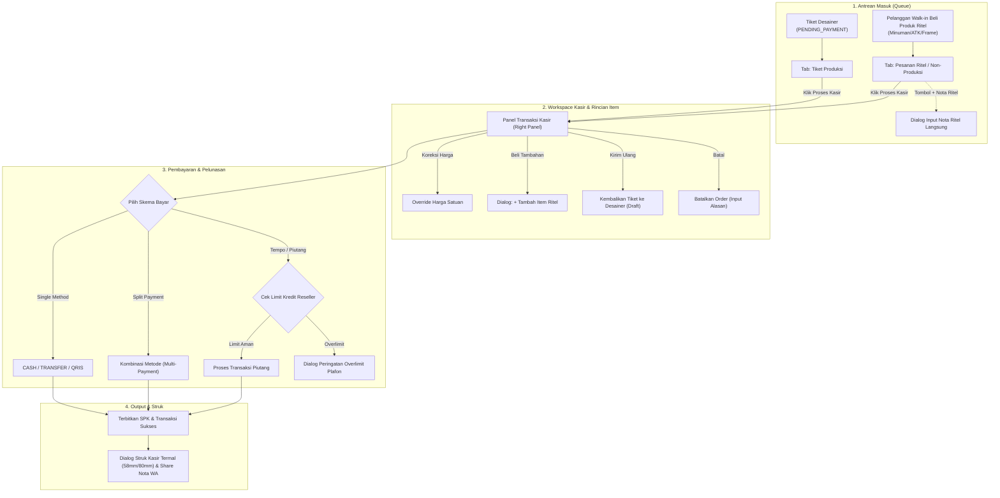

# Mini PRD: Modul Kasir & Pembayaran (Point of Sale / POS)

**Made Printing Digital Printing ERP**  
_Dokumen Spesifikasi Fungsional, Konsep Antrean & Transaksi Kasir, dan Actionable Todo List_

---

## 1. Ringkasan Eksekutif & Latar Belakang

Modul **Kasir & Pembayaran (POS)** adalah simpul sentral transaksi finansial dan jembatan alur kerja antara tim **Pra-Cetak / Desainer** dan **Pelanggan Walk-In**.

Dalam operasional percetakan digital, terdapat dua jenis aliran pesanan yang harus ditangani kasir:

1. **Tiket Produksi (Design-to-Cashier)**: Tiket cetak kustom (spanduk outdoor, cetak A3+, DTF, merchandise) yang telah dikalkulasi spesifikasi teknisnya oleh desainer, berstatus `PENDING_PAYMENT` (antrean butuh bayar/DP sebelum SPK terbit ke operator mesin).
2. **Pesanan Ritel / Non-Produksi (Direct Counter Sales)**: Penjualan langsung barang jadi/non-cetak (misal: minuman dingin, ATK, standing roll-up banner kosongan, pigura/frame foto, merchandise ready-stock) yang dibeli pelanggan walk-in langsung di meja kasir tanpa proses desain.

---

## 2. Alur Transaksi & Diagram Workflow



---

## 3. Spesifikasi Antarmuka Pengguna (UI / UX)

Sesuai bahasa visual **Soft Minimal SaaS** dan layout master-detail dari referensi app legacy:

### A. Layout Utama (2 Kolom Desktop / Tabbed Mobile)

- **Top Bar**: Judul `"Kasir & Pembayaran (POS)"`, deskripsi, serta widget status `"Total Antrean: X Transaksi"`.
- **Kolom Kiri (7 Kolom Grid) — Antrean Pesanan**:
  - **Dua Sub-Tab Switcher**:
    - `[Tiket Produksi]` (badge counter antrean cetak dari desainer).
    - `[Pesanan Ritel / Non-Produksi]` (badge counter barang non-cetak).
  - **Quick Search Input**: Filter instan berdasarkan No. Tiket / No. Nota / Nama Pelanggan.
  - **Tombol `+ Nota Ritel`**: Khusus saat tab Ritel aktif untuk membuat transaksi ritel baru.
  - **List Kartu Antrean**:
    - No. Job Tiket (`JOB/20261119/0001`).
    - Badge status semantik (`TIKET PRODUKSI`, `BARU (NEED PAYMENT)`).
    - Identitas Pelanggan + Badge tier (`RETAIL` vs `RESELLER`).
    - Desainer bertugas + Tanggal pembuatan tiket.
    - Ringkasan item (contoh: `AP120 (2 Sisi) (1x), MMT 280 GR (2x)`).
    - Tombol aksi tegas: `Proses Kasir →`.

- **Kolom Kanan (5 Kolom Grid) — Workspace Transaksi Kasir**:
  - **Kondisi Kosong (Empty State)**: Ilustrasi receipt bersih + teks panduan memilih salah satu tiket antrean di panel kiri.
  - **Kondisi Aktif (Tiket Terpilih)**:
    1. **Pelanggan & Desainer**: Nama, telepon, tipe harga, dan nama desainer.
    2. **Detail Item Belanja**:
       - Baris tiap produk dengan UOM, dimensi ($m^2$, meter lari, lembar, pcs), qty, dan kalkulasi subtotal.
       - Input kontrol untuk **mengubah harga per unit** langsung di kasir (jika ada diskon/override).
       - Tombol **`+ Tambah Item Ritel`** untuk menambahkan produk non-produksi ke tiket aktif.
    3. **Subtotal & Total Tagihan**: Highlighted card dengan font besar tebal.
    4. **Tombol Penanganan**:
       - `Kirim ke Draft`: Kembalikan tiket ke antrean desainer jika ada kesalahan teknis sebelum bayar.
       - `Batalkan Order`: Batalkan tiket dengan modal input alasan.
    5. **Panel Pembayaran (Checkout)**:
       - Toggle `Split Pembayaran` (pembayaran campuran).
       - Pilihan metode: **CASH**, **TRANSFER**, **QRIS**, **PIUTANG/TEMPO** (khusus Reseller).
       - Input nominal bayar, kalkulasi kembalian, dan sisa tagihan (DP vs Lunas).
       - Tombol eksekusi: `Konfirmasi Pembayaran & Terbitkan SPK`.

---

## 4. Rincian Fitur Dialog / Modal

| Nama Modal                          | Tujuan & Fungsionalitas                                                                                                                               |
| :---------------------------------- | :---------------------------------------------------------------------------------------------------------------------------------------------------- |
| **`CreateRetailOrderDialog`**       | Membuat nota ritel baru: memilih produk non-produksi (`is_production: false`), memilih qty, input customer walk-in, dan langsung masuk antrean/kasir. |
| **`AddRetailItemDialog`**           | Membuka katalog produk ritel (minuman, frame, dsb) untuk ditambahkan ke dalam tiket cetak yang sedang aktif diproses kasir.                           |
| **`MergeToProductionTicketDialog`** | Menggabungkan transaksi nota ritel yang berdiri sendiri ke tiket produksi pelanggan yang sama agar dibayar dalam 1 nota kasir.                        |
| **`ResellerCreditLimitDialog`**     | Menampilkan sisa plafon kredit reseller, total piutang berjalan, dan validasi apakah transaksi tempo diizinkan atau melebihi limit.                   |
| **`OrderReceiptDialog`**            | Pratinjau struk kasir termal (58mm/80mm), tombol cetak fisik langsung, dan fitur _Click-to-Chat WhatsApp_ dengan auto-copy gambar nota.               |

---

## 5. Rencana Arsitektur Teknis (Clean Architecture + DDD)

```
src/features/cashier/
├── domain/
│   ├── cashier.entity.ts             # Entitas CashierOrder, OrderItem, Payment, Status
│   ├── cashier.repository.ts         # Interface kontrak repository
│   └── cashier.schema.ts             # Zod schema validasi pembayaran kasir
├── infrastructure/
│   ├── cashier.dto.ts                # DTO API / wire format
│   ├── cashier.validator.ts          # Zod validator response backend
│   ├── cashier.mapper.ts             # Anti-Corruption Layer (DTO -> Entity)
│   ├── cashier.repository.impl.ts    # Integrasi API real backend
│   └── cashier.repository.mock.ts    # Mock data antrean produksi & ritel komprehensif
├── application/
│   ├── cashier.store.svelte.ts       # Svelte 5 rune reactive store ($state, $derived)
│   └── cashier.container.ts          # DI composition root (MOCK_FLAGS.cashier)
└── presentation/
    ├── pages/
    │   └── CashierPage.svelte        # Master page 2 kolom (Queue + Checkout)
    └── components/
        ├── CashierQueueList.svelte
        ├── CashierQueueCard.svelte
        ├── CashierCheckoutPanel.svelte
        ├── AddRetailItemDialog.svelte
        ├── CreateRetailOrderDialog.svelte
        ├── MergeToProductionTicketDialog.svelte
        ├── ResellerCreditLimitDialog.svelte
        └── CashierReceiptDialog.svelte
```

---

## 6. Actionable Todo List (Tahapan Eksekusi)

### Tahap 1: Persiapan Domain, Kontrak, & Mock Data

- [x] Buat `src/features/cashier/domain/cashier.entity.ts` (Model CashierOrder, CashierOrderItem, CashierPaymentMethod).
- [x] Buat `src/features/cashier/domain/cashier.repository.ts` (Kontrak use-cases: getCashierOrders, processPayment, cancelOrder, sendToDraft, createRetailOrder, mergeToProductionTicket).
- [x] Buat `src/features/cashier/domain/cashier.schema.ts` (Zod validation form checkout pembayaran kasir).
- [x] Buat DTO, Mapper, dan Mock Repository di `src/features/cashier/infrastructure/` dengan data simulasi realistis:
  - 2 Tiket Produksi dari Desainer (`PENDING_PAYMENT`).
  - 1 Nota Ritel Standalone (Standing Roll-Up & Minuman).
  - Data Reseller dengan simulasi limit kredit.
- [x] Hubungkan ke composition root `cashier.container.ts` dan daftarkan `cashier` pada `MOCK_FLAGS`.

### Tahap 2: Reactive Application State (Svelte 5 Runes)

- [x] Implementasikan `cashier.store.svelte.ts`:
  - `$state activeTab` (`PRODUCTION` vs `RETAIL`).
  - `$state selectedOrderId` & `$derived activeOrder`.
  - `$state searchQuery` & `$derived filteredQueue`.
  - `$derived subtotal`, `$derived grandTotal`, `$derived remainingAmount`, `$derived changeAmount`.
  - `$state isSplitPayment`, `$state splitAmounts`, `$state paymentMethod`.
  - Method `updateItemPrice(orderId, itemId, newPrice)`.
  - Method `addRetailItem(orderId, item)`.
  - Method `removeItem(orderId, itemId)`.
  - Method `processPayment()`.

### Tahap 3: Navigasi & Wire Route Halaman Kasir

- [x] Perbarui `app.nav.ts`: Menu di sidebar: `title: 'Kasir'`, `href: '/cashier'`, `icon: IconShoppingBag`.
- [x] Pastikan route `src/routes/(app)/cashier/+page.svelte` aktif sebagai container utama memanggil `CashierPage.svelte`.
- [x] Pastikan route legacy `/pos`, `/orders/new`, `/orders` ter-redirect mulus ke `/cashier`.

### Tahap 4: Antarmuka Antrean Pesanan (Left Panel)

- [x] Implementasikan `CashierQueueList.svelte`:
  - Tab switcher `Tiket Produksi` vs `Pesanan Ritel / Non-Produksi` dengan badge counter antrean.
  - Search bar interaktif.
  - Tombol `+ Nota Ritel` saat tab ritel aktif.
  - Komponen kartu `CashierQueueCard.svelte` dengan layout rapi dan tombol `Proses Kasir →`.

### Tahap 5: Antarmuka Workspace Kasir & Rincian Item (Right Panel)

- [x] Implementasikan `CashierCheckoutPanel.svelte`:
  - Empty state saat belum ada tiket yang dipilih.
  - Section Pelanggan (Retail / Reseller, telepon, desainer).
  - List item belanja dengan UOM dan dimensi.
  - Input override harga satuan kasir.
  - Tombol aksi `Kirim ke Draft` & `Batalkan Order`.
  - Tombol `+ Tambah Item Ritel`.

### Tahap 6: Dialog Transaksi Ritel & Cek Kredit

- [x] Implementasikan `CreateRetailOrderDialog.svelte` (modal nota ritel walk-in mandiri).
- [x] Implementasikan `AddRetailItemDialog.svelte` (modal tambah barang ritel ke tiket cetak aktif).
- [x] Implementasikan `ResellerCreditLimitDialog.svelte` (proteksi piutang jika reseller belanja tempo).
- [x] Implementasikan `MergeToProductionTicketDialog.svelte` (gabung nota ritel ke tiket cetak).

### Tahap 7: Formulir Pembayaran, Split Payment, & Struk Kasir

- [x] Implementasikan kontrol pembayaran di bawah rincian item (Single Cash/Transfer/QRIS/Tempo vs Split Payment).
- [x] Implementasikan kalkulasi kembalian dan sisa bayar (DP / Lunas).
- [x] Implementasikan `CashierReceiptDialog.svelte` (pratinjau struk termal, print, kirim WA).

### Tahap 8: Verifikasi & Testing

- [ ] Unit testing untuk mapper dan repository (`order.mapper.spec.ts`, `order.repository.mock.spec.ts`).
- [ ] Validasi kalkulasi subtotal, split payment, dan kembalian.
- [ ] Jalankan `npm run check` (0 error) dan `npx vitest run`.
