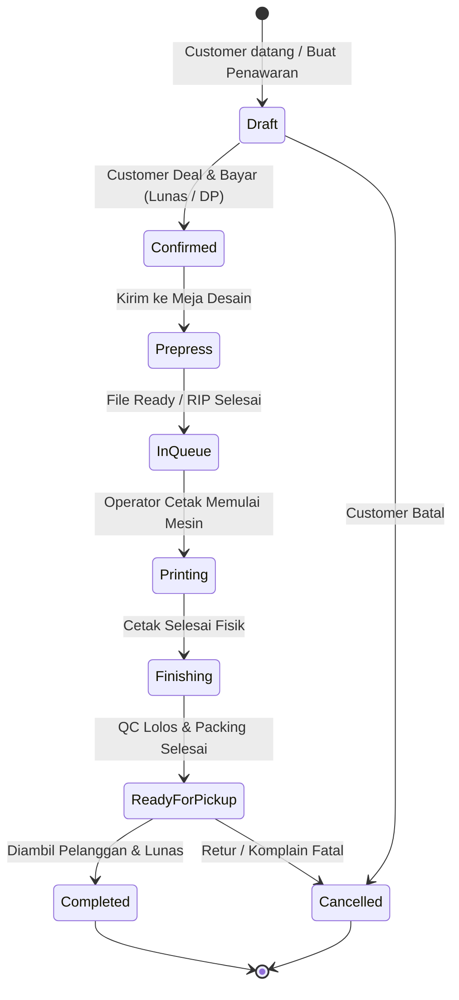

# 02. Siklus Hidup Pesanan & Dokumen SPK (Surat Perintah Kerja)

Dokumen ini menjelaskan alur status pesanan (_order lifecycle_), transisi status, serta struktur data dokumen **SPK**.

---

## 1. Diagram Transisi Status Pesanan

---

## 2. Definisi Status & Perilaku Sistem

| Status Code        | Label UI                       | Trigger Transisi                                                                   | Data Yang Wajib Ada                                                                               |
| :----------------- | :----------------------------- | :--------------------------------------------------------------------------------- | :------------------------------------------------------------------------------------------------ |
| `draft`            | **Draft**                      | Kasir menginput item, namun customer belum membayar atau file belum diserahkan.    | Daftar item, dimensi dasar. Belum ada nomor SPK resmi.                                            |
| `confirmed`        | **Terkonfirmasi / SPK Terbit** | Pembayaran DP (min. 50%) atau Lunas diterima kasir.                                | Nomor SPK dibuat, nomor antrian kasir, metode pembayaran tercatat.                                |
| `prepress`         | **Pengecekan File**            | Tim pre-press membuka file, memeriksa bleed & mode warna.                          | File link / upload tersimpan, catatan kelayakan file.                                             |
| `in_queue`         | **Antrian Cetak**              | File sudah matang (RIP ready) dan dialokasikan ke mesin cetak tertentu.            | ID Mesin yang ditunjuk, estimasi jam cetak.                                                       |
| `printing`         | **Sedang Dicetak**             | Operator mengklik "Mulai Cetak" pada mesin.                                        | ID Operator cetak, timestamp mulai.                                                               |
| `finishing`        | **Proses Finishing**           | Cetakan fisik keluar dari mesin, berpindah ke meja finishing.                      | Timestamp cetak selesai, penugasan operator finishing.                                            |
| `ready_for_pickup` | **Siap Diambil / Kirim**       | Finishing tuntas dan lolos inspeksi Quality Control (QC).                          | Rak/lokasi penyimpanan barang jadi (_Bin Location_). Sistem dapat trigger notifikasi WA otomatis. |
| `completed`        | **Selesai**                    | Barang diserahkan ke pelanggan dan seluruh sisa tagihan telah lunas.               | Timestamp serah terima, nama penerima, bukti pelunasan kasir.                                     |
| `cancelled`        | **Dibatalkan**                 | Pesanan dibatalkan (misal file rusak parah / pelanggan membatalkan sebelum cetak). | Alasan pembatalan, data refund kasir jika ada DP.                                                 |

---

## 3. Tingkat Prioritas Pesanan (_Priority Levels_)

Pesanan memiliki 3 level prioritas yang mempengaruhi susunan antrian mesin:

1. **Urgent / Same-Day Service (Prioritas Tertinggi)**:
   - Harus selesai dalam hitungan 1–3 jam.
   - Ditandai dengan badge merah menyala di antrian operator.
   - Sering kali dikenakan surcharge/biaya tambahan ekspres.
2. **Prioritas Kilat (Next Day)**:
   - Selesai pada hari kerja berikutnya sebelum jam tertentu.
3. **Reguler (Standar)**:
   - Waktu produksi normal (2–3 hari kerja).

---

## 4. Anatomi Dokumen SPK (Surat Perintah Kerja)

SPK adalah lembar kerja produksi yang dicetak atau ditampilkan pada tablet operator bengkel:

### Elemen Data SPK:

1. **Header SPK**:
   - Nomor SPK (contoh: `SPK-202611-0042`)
   - Barcode / QR Code SPK (dapat di-scan dengan barcode scanner untuk memperbarui status instan)
   - Tanggal & Jam Masuk Order
   - **Target Selesai (Deadline & Jam)**
   - Badge Prioritas (`REGULER` vs `EXPRESS`)
2. **Informasi Pelanggan**:
   - Nama Customer / Nama Instansi
   - Nomor WhatsApp (untuk konfirmasi teknis jika file bermasalah)
3. **Spesifikasi Teknis Tiap Item**:
   - Nama Pekerjaan (contoh: _Banner HUT RI RT 05_)
   - Kategori Produk & Nama Bahan (contoh: _Flexy Outdoor 340 gsm_)
   - Dimensi Cetak: Panjang $\times$ Lebar (contoh: $300 \times 100\ \text{cm} = 3.00\ m^2$)
   - Jumlah Cetak (Qty: 2 pcs &rarr; Total $6.00\ m^2$)
   - Mode Cetak: 1 Sisi (4/0) / 2 Sisi Bolak-balik (4/4)
   - Instruksi Finishing Detail:
     - `mata_ayam`: 4 sudut
     - `seaming`: lipat keliling
4. **Instruksi Khusus Produksi**:
   - Catatan desainer: _“Warna background merah cabai, jangan sampai keunguan”_.
5. **Bagian Tracking Tanda Tangan**:
   - Paraf Desainer Pre-press
   - Paraf Operator Cetak
   - Paraf Operator Finishing & QC
