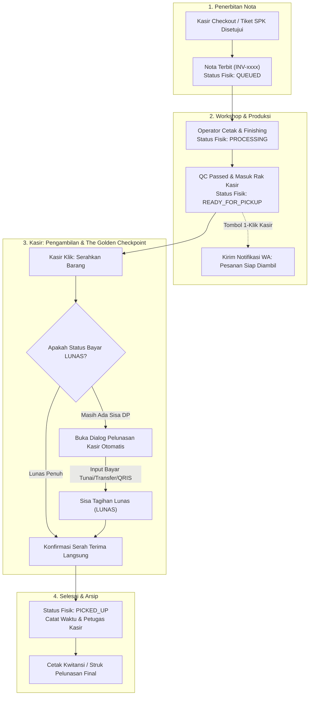

# Mini PRD: Modul Invoice & Monitoring Nota Pesanan

**Made Printing Digital Printing ERP**  
_Dokumen Spesifikasi Fungsional, Konsep Alur Twin Status (Fulfillment & Finansial), dan Actionable Roadmap_

---

## 1. Ringkasan Eksekutif & Latar Belakang

Modul **Invoice & Monitoring Nota Pesanan** adalah pusat kendali operasional serah-terima produk cetak dan penagihan kas di meja kasir depan (*front desk*).

Dalam operasional percetakan digital (*digital printing*), nota/faktur kasir bukan sekadar catatan akuntansi pasif, melainkan **tiket kendali fisik dan finansial**:

1. **Kendali Serah-Terima Barang (Fulfillment Control)**:
   Pelanggan sering datang ke kasir membawa nomor nota (`INV-xxx`) atau bertanya via WhatsApp mengenai status pesanannya. Kasir membutuhkan visibilitas instan: apakah pesanan masih di mesin cetak, sedang di-finishing, sudah diletakkan di rak siap ambil, atau sudah diserahkan ke pelanggan.
2. **Pencegahan Piutang Lolos (*The Golden Checkpoint*)**:
   Banyak transaksi cetak dibuat dengan skema **Uang Muka / DP 50%**. Saat pelanggan mengambil barang jadi, kasir wajib memastikan sisa tagihan dilunasi terlebih dahulu sebelum barang fisik keluar dari outlet (kecuali reseller dengan fasilitas akun piutang/tempo resmi).
3. **Manajemen Rak & Paket Mengendap**:
   Memudahkan kasir mendeteksi pesanan yang sudah selesai dicetak namun belum diambil berhari-hari (*abandoned pickup*), lengkap dengan nomor rak penyimpanan dan fitur kirim pengingat WhatsApp 1-klik.

---

## 2. Alur Transaksi & Diagram Workflow

Sistem menerapkan arsitektur **Twin Status (Status Ganda)** yang memisahkan status pengerjaan fisik (*fulfillment*) dan status pembayaran (*financial*):



---

## 3. Spesifikasi Status Ganda (*The Twin Status Specs*)

### A. Dimensi Fisik / Pengerjaan (`fulfillmentStatus`):

| Status Code | Label UI | Warna Token Semantik | Deskripsi Operasional |
| :--- | :--- | :--- | :--- |
| `QUEUED` | Baru / Antrean | `text-foreground-subtle bg-surface-subtle` | Nota baru diterbitkan, menunggu giliran pengerjaan operator. |
| `PROCESSING` | Sedang Diproses | `text-sky-700 bg-sky-50 dark:text-sky-300 dark:bg-sky-950/40` | File masuk mesin cetak (Outdoor/Indoor/A3+/DTF) atau tahap finishing (seaming, mata ayam, potong). |
| `READY_FOR_PICKUP` | Siap Diambil | `text-amber-700 bg-amber-50 dark:text-amber-300 dark:bg-amber-950/40` | Produk selesai QC, diletakkan di rak toko/kasir. Trigger notifikasi WA siap ambil aktif. |
| `PICKED_UP` | Sudah Diambil | `text-emerald-700 bg-emerald-50 dark:text-emerald-300 dark:bg-emerald-950/40` | Produk resmi diserahkan ke pelanggan. Dicatat tanggal, jam, dan staf yang melayani. |

### B. Dimensi Finansial / Pembayaran (`paymentStatus`):

| Status Code | Label UI | Warna Token Semantik | Deskripsi Finansial |
| :--- | :--- | :--- | :--- |
| `LUNAS` | Lunas | `text-emerald-700 bg-emerald-50 dark:text-emerald-300 dark:bg-emerald-950/40` | Tagihan terbayar penuh 100%. |
| `PARTIAL_PAID` | DP / Sebagian | `text-amber-700 bg-amber-50 dark:text-amber-300 dark:bg-amber-950/40` | Pembayaran awal (DP) diterima, ada sisa piutang wajib lunas saat ambil. |
| `UNPAID` | Tempo Reseller | `text-indigo-700 bg-indigo-50 dark:text-indigo-300 dark:bg-indigo-950/40` | Khusus mitra reseller yang memiliki termin waktu pembayaran (TOP). |
| `OVERDUE` | Jatuh Tempo | `text-rose-700 bg-rose-50 dark:text-rose-300 dark:bg-rose-950/40` | Melewati tanggal batas tempo pembayaran reseller. |

---

## 4. Spesifikasi Antarmuka Pengguna (UI / UX)

Sesuai bahasa visual **Soft Minimal SaaS** dan token dari `dystopia-linear-lib`:

### A. KPI Summary Metrics Header (4 Cards):
1. **Total Nota Berjalan**: Jumlah akumulasi seluruh nota aktif di sistem.
2. **Sedang Diproses**: Jumlah pesanan yang sedang berada di lantai workshop / pengerjaan.
3. **Siap Diambil di Rak**: Jumlah paket yang sudah jadi di rak kasir dan siap diambil (highlight perhatian kasir).
4. **Sisa Piutang Berjalan**: Akumulasi rupiah sisa tagihan DP & tempo yang belum masuk kas.

### B. Segmented Pill Tabs (Linear-Style Sliding Indicator):
- `Semua Nota`: Tampilan master seluruh transaksi faktur.
- `Sedang Diproses`: Memfilter pesanan yang berstatus `QUEUED` & `PROCESSING`.
- `Siap Diambil`: Memfilter pesanan `READY_FOR_PICKUP` (lengkap dengan counter badge oranye).
- `Sudah Diambil`: Riwayat nota yang telah diserahkan ke pelanggan (`PICKED_UP`).
- `Belum Lunas`: Filter silang (*cross-filter*) untuk melihat semua nota yang memiliki sisa pembayaran (`remainingAmount > 0`).

### C. Kolom Tabel Monitoring Nota:
1. **No. Nota & Tipe Order**: Nomor faktur (`INV/202611/0001`), badge tipe (`Produksi` vs `Ritel`), dan jumlah item.
2. **No. SPK & Waktu**: Nomor SPK kerja terkait dan tanggal terbit.
3. **Pelanggan & Kontak**: Nama customer, badge tier (`Walk-in` vs `Reseller`), dan nomor telepon.
4. **Status Pengerjaan & Lokasi Rak**: Badge fisik (`Sedang Diproses`, `Siap Diambil`, dsb.) + tag lokasi (misal: `Rak A-02`).
5. **Status Pembayaran**: Badge finansial (`Lunas`, `DP 50%`, `Tempo`).
6. **Total & Sisa Tagihan**: Nilai total faktur dan nilai sisa piutang (merah jika masih ada sisa).
7. **Aksi Cepat Kasir**:
   - `IconEye`: Lihat rincian faktur & log pembayaran.
   - `IconCheckCircle2`: **Tombol Serah Terima / Sudah Diambil** (membuka guard pelunasan jika belum lunas).
   - `IconShare2`: Kirim pesan WhatsApp notifikasi siap ambil / rekap nota.
   - `IconPrinter`: Cetak struk kasir termal atau faktur standar A4.

---

## 5. Rincian Fitur Dialog / Modal

| Nama Modal | Tujuan & Fungsionalitas |
| :--- | :--- |
| **`InvoiceDetailDialog`** | Menampilkan rincian teknis pesanan, itemized products, log riwayat pembayaran bertahap, status pengerjaan, dan lokasi rak kasir. |
| **`InvoicePickupDialog`** | **The Golden Checkpoint Dialog**: Konfirmasi serah terima barang. Jika belum lunas, otomatis menyajikan input pembayaran pelunasan sisa sebelum status barang diubah ke `PICKED_UP`. |
| **`InvoicePaymentDialog`** | Form pencatatan pelunasan mandiri sisa tagihan (metode: Tunai, Transfer, QRIS, input nomor referensi bukti transfer, dan catatan). |
| **`InvoiceReceiptDialog`** | Pratinjau cetak struk kasir termal (58mm/80mm) dan faktur resmi A4, tombol cetak langsung browser, serta tombol _Click-to-Chat WhatsApp_. |

---

## 6. Rencana Arsitektur Teknis (Clean Architecture + DDD)

```
src/features/invoices/
├── domain/
│   ├── invoice.entity.ts         # Entitas Invoice, InvoiceItem, InvoiceStats, Status Types
│   ├── invoice.repository.ts     # Interface kontrak repository & query params
│   └── invoice.schema.ts         # Zod validation schema untuk pelunasan & serah-terima
├── infrastructure/
│   ├── invoice.dto.ts            # DTO wire format backend
│   ├── invoice.validator.ts      # Validasi response API
│   ├── invoice.mapper.ts         # Anti-Corruption Layer (DTO <-> Entity)
│   ├── invoice.repository.mock.ts# In-memory mock repository dengan skenario serah-terima
│   └── invoice.repository.impl.ts# Implementasi repository HTTP API
├── application/
│   ├── invoice.container.ts      # DI container resolver
│   └── invoice.store.svelte.ts   # Svelte 5 runes state store (filters, counters, actions)
└── presentation/
    ├── pages/
    │   └── InvoiceListPage.svelte# Halaman utama monitoring nota pesanan
    └── components/
        ├── InvoiceDetailDialog.svelte
        ├── InvoicePaymentDialog.svelte
        ├── InvoicePickupDialog.svelte   # Modal serah-terima + auto pelunasan
        └── InvoiceReceiptDialog.svelte
```

---

## 7. Actionable Roadmap & Task List (Next Sessions)

- [ ] **Milestone 1: Domain & Infrastructure Expansion**
  - [ ] Tambahkan field `fulfillmentStatus` (`'QUEUED' | 'PROCESSING' | 'READY_FOR_PICKUP' | 'PICKED_UP'`) pada `Invoice`.
  - [ ] Tambahkan field `rackLocation?: string`, `pickedUpAt?: string`, `pickedUpBy?: string` pada `Invoice`.
  - [ ] Perbarui DTO, Zod schema, dan mapper.
  - [ ] Tambahkan method `markAsPickedUp(invoiceId, paymentInput?)` dan `updateFulfillmentStatus(invoiceId, status, rackLocation?)` pada repository mock & interface.

- [ ] **Milestone 2: Application Store Updates**
  - [ ] Tambahkan reactive filter `fulfillmentFilter` pada `InvoiceStore`.
  - [ ] Tambahkan derived counters: `processingCount`, `readyForPickupCount`, `pickedUpCount`.
  - [ ] Tambahkan method store `pickupOrder(invoiceId, settlePaymentInput?)`.

- [ ] **Milestone 3: UI & Components Refactoring**
  - [ ] Buat komponen modal `InvoicePickupDialog.svelte` (*The Golden Checkpoint*).
  - [ ] Sesuaikan segmented tabs pada `InvoiceListPage.svelte` agar berorientasi pada status fisik pengerjaan (`Semua`, `Sedang Diproses`, `Siap Diambil`, `Sudah Diambil`).
  - [ ] Tambahkan badge visual status pengerjaan dan lokasi rak pada baris tabel.
  - [ ] Tambahkan aksi 1-klik WhatsApp Notifikasi Siap Ambil.

- [ ] **Milestone 4: Verification, Tests & Quality Gates**
  - [ ] Jalankan `npm run check` (0 error, 0 warning).
  - [ ] Tambahkan unit test vitest untuk skenario serah terima barang lunas vs belum lunas.
  - [ ] Jalankan `npx eslint src/features/invoices`.
  - [ ] Update knowledge graph AST via `graphify update .`.
